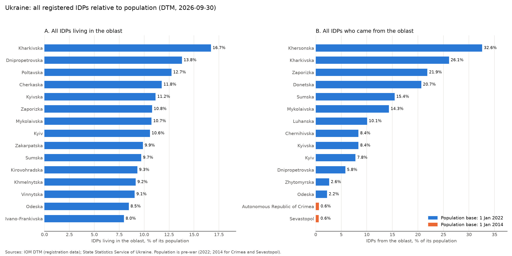
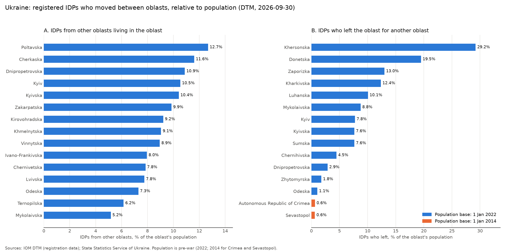
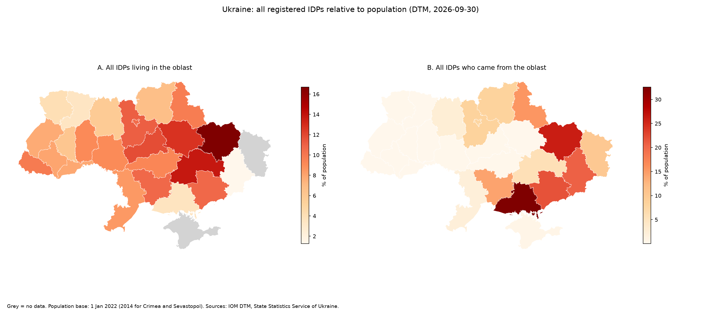
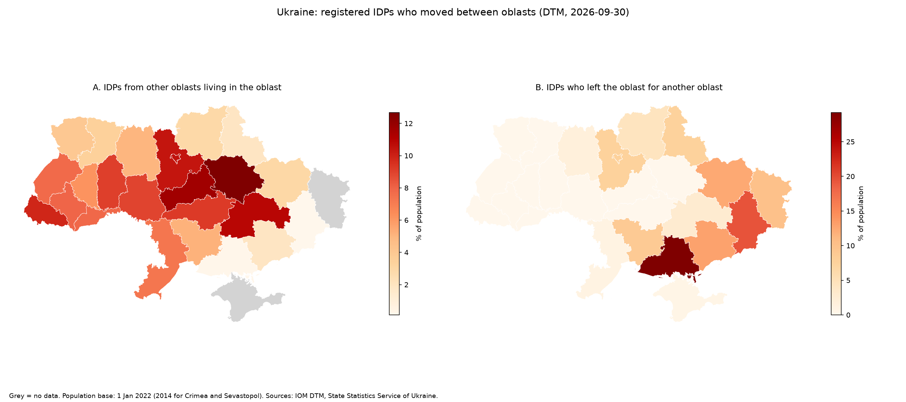

# DTM Ukraine IDP project
# Internally displaced persons in Ukraine: IOM DTM data vs. population

Course project for *VU Tools in Data Science* (University of Vienna, WS 2026).
The code was written with AI assistance (Claude, GitHub Copilot), which the course allows.

## Question

How many registered internally displaced persons (IDPs) are there in Ukraine, where do they live,
where do they come from, and how large is that compared with the pre-war population of each oblast?

## Data

| Data | Source | Notes |
|---|---|---|
| IDPs by oblast of residence and oblast of origin, 2022-02 to 2026-09 | IOM Displacement Tracking Matrix (DTM) API v3, `get_idp_admin1_data("Ukraine")` | needs a free API key; 53 reporting rounds |
| Population by oblast | State Statistics Service of Ukraine, 1 January 2022 (figures taken from the Wikipedia table "List of Ukrainian oblasts and territories by population", total 41,167,335 without Crimea and Sevastopol) | pre-war population |
| Population of Crimea and Sevastopol | State Statistics Service of Ukraine, "Resident population", 1 January 2014 | 1,958,500 and 383,900 (source gives thousands, "Sevastopol agglomeration") |
| Oblast boundaries | OCHA / HDX, *Ukraine - Subnational Administrative Boundaries* (COD-AB, version 05), file `ukr_admin1.geojson` | 27 oblasts |

IDP definition: a person forced to leave their home but still living in their own country.

## How to run

```
pip install -r requirements.txt
$env:DTMAPI_SUBSCRIPTION_KEY = "<your key>"   # PowerShell, valid for this window only; never commit the key
python dtm_ukraine.py            # download -> data/ukraine_admin1_raw.csv
python dtm_ukraine_clean.py      # registration rows only -> data/ukraine_admin1_monthly.csv
python ukraine_population.py     # data/ukraine_population.csv
python ukraine_shares.py         # data/ukraine_share_hosted.csv, data/ukraine_share_origin.csv
python ukraine_plots.py          # ukraine_shares_all.png, ukraine_shares_moved.png
python ukraine_map.py            # ukraine_map_all.png, ukraine_map_moved.png
```
`dtm_ukraine_explore.py` and `dtm_ukraine_check.py` are the exploration scripts that revealed the issue below.
Download `ukr_admin1.geojson` from HDX and save it as `data/ukraine_admin1.geojson` before running the map script
(it is not stored in this repository).

## An important data pitfall

The DTM table contains two values of the column `operation`:

* "... (Registration)": 34,389 rows, about 650 per reporting date (one row per oblast of residence and oblast of origin);
* "... in Ukraine" without "(Registration)": 161 rows = 7 dates x 23 oblasts, with round values (for example 3,671,000).
  Its nature is not documented in the data; it looks like a separate estimate.

On 5 dates both sets exist for the same day (2024-08-31, 2024-10-31, 2025-04-30, 2025-12-31, 2026-03-31).
A plain `sum` per date then adds two counts of the same people and gives about 7 million instead of about 3.4 million.
On the same date the two sources differ by about 5-13%. This project uses **registration rows only**.
The 23-row set is kept out of the analysis.

## Method

For the latest round (2026-09-30), registered IDPs: 3,481,336.

* **Hosted share:** IDPs living in an oblast / population of that oblast.
* **Origin share:** IDPs whose oblast of origin is X / population of X.
* Each is calculated in two versions:
  1. **All IDPs**, including people who moved inside their own oblast;
  2. **Only people who moved to another oblast** (oblast of residence is different from oblast of origin).

## Results






* Share of the pre-war population that is now displaced (all IDPs): Kherson 32.6%, Kharkiv 26.1%, Zaporizhzhia 21.9%, Donetsk 20.7%.
* Many displaced people stay in their own oblast: 356,768 of 677,952 IDPs from Kharkiv oblast (53%) still live there.
  Counting only people who moved to another oblast: Kherson 29.2%, Donetsk 19.5%, Zaporizhzhia 13.0%, Kharkiv 12.4%, Luhansk 10.1%.
* Hosting people from other oblasts, as share of the oblast's own population: Dnipropetrovsk oblast about 10.9%, Kharkiv oblast about 3.0%.
* Largest single flows: Donetsk to Dnipropetrovsk (189,583), Donetsk to Kyiv city (103,599).
* Total registered IDPs grew slowly from 3.37 million (2025-10-30) to 3.48 million (2026-09-30).

## Limitations

* The denominator is the **pre-war population** (1 January 2022; 1 January 2014 for Crimea and Sevastopol), so shares are not comparable between those two groups.
  It includes areas that are now occupied (parts of Donetsk, Luhansk, Kherson and Zaporizhzhia oblasts), while the numerator counts only IDPs registered in the controlled area.
* The data counts registered IDPs who are still displaced. It excludes refugees abroad, returnees and unregistered people.
* DTM has no row for Luhansk oblast or for Crimea as a place of residence (they appear only as origins), so these are grey on the "living in" maps.
  The category "Occupied or partially occupied Oblast" (12,589 IDPs) has no population and is not mapped.
* Reporting dates are not always at the end of the month, and January and March 2025 are missing in the registration series.
* The 2022 population numbers were copied from Wikipedia, which cites the State Statistics Service; the total was checked against the expected value, but the individual numbers were not compared with the original source.